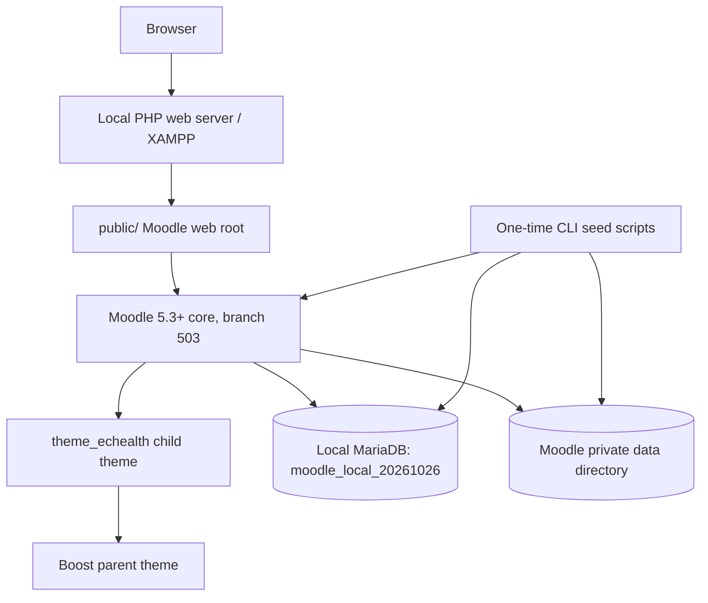
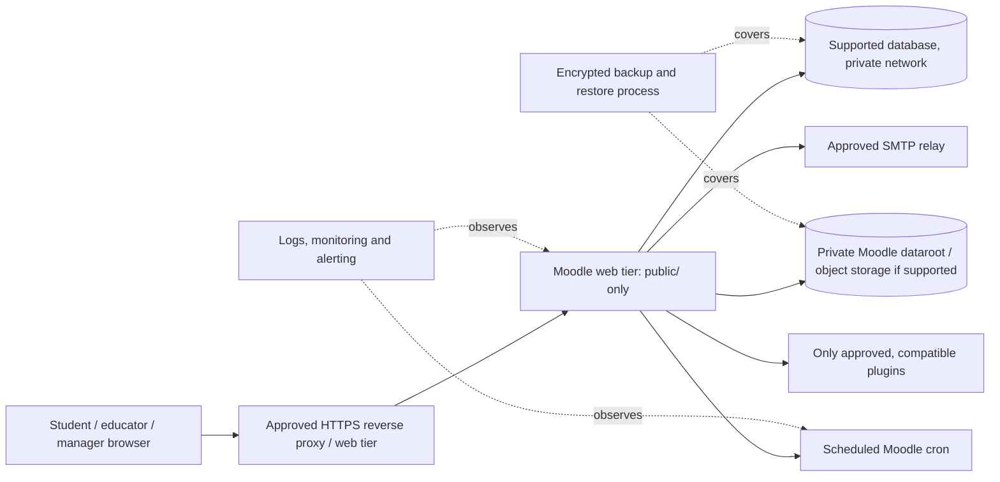

# Moodle architecture: current proof of concept and proposed demonstration

**Audit date:** 26 October 2026. This document describes observed source/configuration and local records separately from the proposed target. It is not a production deployment design approval.

## Existing local architecture

### Observed components and evidence

- Moodle release in `public/version.php`: `5.3+ (Build: 20261021)`, branch `503`.
- Public document root is `public/`; local URL is `http://localhost:8080`; `config.php` points to local MariaDB and a data directory outside the web root. Secret values are intentionally omitted here.
- Local site returned HTTP 200 during inspection. PHP CLI path documented as `C:\xampp8.5\php\php.exe`, version 8.5.12 in existing installation notes. Those notes identify PHP 8.5 support as in development for this Moodle release; local runtime is not production evidence.
- `theme_echealth` inherits Boost in `public/theme/echealth/config.php`. It adds a department masthead, supplied PNG, government-colour strip, SCSS and child templates for navbar, login and footer. The supplied asset is `public/theme/echealth/pix/ec-health-logo.png`.
- Core site/course records: 6 demo categories/cohorts, 36 course offerings, 30 learners, six educators, two training administrators, one training manager, 216 enrolments, 36 Pages, 36 Assignments, 72 grade items. No quizzes, grades or completions found. No attendance/certificate plugin tables found.
- Demo records are synthetic and content is explicitly illustrative. Seed scripts guard for localhost, expected database/data path and one-time markers. They store generated credentials under the private data directory. Do not rerun against an already seeded installation.
- No Docker or compose files were observed in root inventory. Existing notes are `docs/echealth-installation.md`, `docs/echealth-implementation-plan.md`, `docs/echealth-compliance-matrix.md`.

## Proposed demonstration architecture

The diagram is a target concept, not proof of deployed infrastructure. Select exact runtime versions against the supported Moodle release matrix, protect the database and dataroot from public access, configure HTTPS, cron, mail and backups, and test restore before presenting operational claims.

## Functional boundaries

### Moodle can provide in the proposed demo

Native courses and learning resources, enrolments, course roles, quizzes/question bank, Assignments/rubrics, gradebook, completion, calendar/forums, course reports and standard exports. These capabilities require configuration and end-to-end tests; presence in core is not evidence of an active workflow.

### Conditions and limits

- Categories, cohorts and groups organize courses and enrolments; they do not by themselves isolate campus data as separate tenants. System-context manager access must be restricted and tested.
- Attendance and printable/downloadable certificates require a compatible plugin or an explicitly accepted alternative; none are installed/evidenced now.
- Cross-campus reporting may need a supported report plugin or custom development and governance review. Standard course reports do not establish regulatory reporting compliance.
- Admissions, student lifecycle, finance, payroll/Persal, hospital placement allocation and official regulatory submissions are outside this configured LMS proof of concept and need separate systems/integration scope.
- Moodle configuration does not establish POPIA compliance, government certification, clinical governance approval, SLA or performance capacity.

## Proposed implementation sequence

1. Approve source proposal, identity references, runtime and hosting boundary.
2. Validate child theme/navigation and least-privilege roles.
3. Reconcile catalogue and complete the Infection Prevention and Control flagship learning journey.
4. Configure assessments, gradebook and completion; add optional plugins only after compatibility testing.
5. Build honest role-authorized reports and synthetic demonstration records.
6. Complete accessibility, security, backup/restore, regression and timed demo rehearsals.

See [`TODO.md`](../TODO.md), [`FEATURE_COMPLIANCE_MATRIX.md`](FEATURE_COMPLIANCE_MATRIX.md), [`DEMO_WALKTHROUGH.md`](DEMO_WALKTHROUGH.md), and [`DEMO_READINESS.md`](DEMO_READINESS.md) for acceptance evidence and outstanding tasks.
